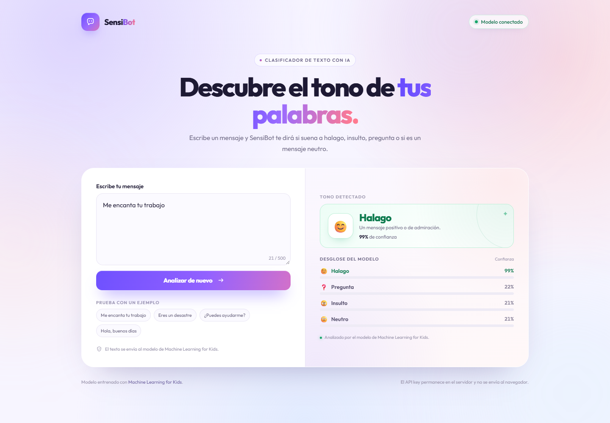

# SensiBot

Aplicación web que usa el modelo de clasificación de texto creado en
**Machine Learning for Kids**. Escribe un mensaje y SensiBot mostrará si el modelo
lo interpreta como **halago**, **insulto**, **pregunta** o **neutro**, junto con la
confianza de cada categoría.



## Requisitos

- Python 3.8 o superior.
- Conexión a internet para consultar el modelo de Machine Learning for Kids.
- No hace falta instalar librerías externas: se usa solo la biblioteca estándar.

## Cómo ejecutarla

### Windows

Haz doble clic en **`iniciar.bat`**.

### Linux o macOS

```bash
chmod +x iniciar.sh
./iniciar.sh
```

### Cualquier sistema con Python

```bash
py servidor.py
```

o:

```bash
python3 servidor.py
```

El servidor abrirá el navegador automáticamente y mostrará la dirección en la
terminal. Por defecto es <http://localhost:3000>. Si ese puerto está ocupado,
probará el 3001, 3002, etc.

## Configuración

La clave del proyecto se guarda en el archivo **`.env`**, que está ignorado por Git:

```env
ML4KIDS_API_KEY=tu_api_key_aqui
PORT=3000
```

Si descargas el repositorio en otro equipo:

```bash
cp .env.example .env
```

Después, escribe tu clave en `.env` y vuelve a iniciar el servidor.

> **Importante:** la clave de Machine Learning for Kids debe tratarse como una
> contraseña. No la subas al repositorio ni la compartas. El servidor la usa
> internamente y nunca la envía al navegador.

## Clases del modelo

| Emoji | Clase | Significado |
| --- | --- | --- |
| 😊 | Halago | Un mensaje positivo o de admiración. |
| 😠 | Insulto | Un mensaje negativo u ofensivo. |
| ❓ | Pregunta | Una consulta o petición de información. |
| 😐 | Neutro | Un mensaje sin una carga emocional clara. |

Ejemplos que funcionan bien:

- `Me encanta tu trabajo` → Halago
- `Eres un desastre` → Insulto
- `¿Puedes ayudarme?` → Pregunta
- `Hola, buenos días` → Neutro

Los resultados pueden variar según cómo esté entrenado el modelo.

## Cómo funciona

1. El navegador envía el mensaje al servidor local de Python.
2. El servidor consulta la API de Machine Learning for Kids usando la clave privada.
3. La respuesta se devuelve al navegador, que muestra la categoría principal y el
   desglose de confianza.

El servidor local es necesario porque la API de Machine Learning for Kids no permite
llamadas directas desde el navegador (CORS). Así también se evita exponer la clave.

## Estructura

```text
SensiBot/
├── index.html       Interfaz de la aplicación
├── styles.css       Diseño visual y responsive
├── app.js           Envío del mensaje y presentación de resultados
├── servidor.py      Servidor local y puente con la API
├── iniciar.bat      Lanzador para Windows
├── iniciar.sh       Lanzador para Linux/macOS
├── .env.example     Ejemplo de configuración
└── README.md
```

## Publicación

La aplicación necesita ejecutar Python en un servidor; no puede publicarse sola en
GitHub Pages. Para tener un enlace público se puede desplegar en un servicio como
Render o Railway, configurando `ML4KIDS_API_KEY` como variable de entorno y
`HOST=0.0.0.0`.

## Repositorio

<https://github.com/CrisHub2002/SensiBot>

---

Proyecto para **T1.2 Crear tu segundo modelo de IA**.
